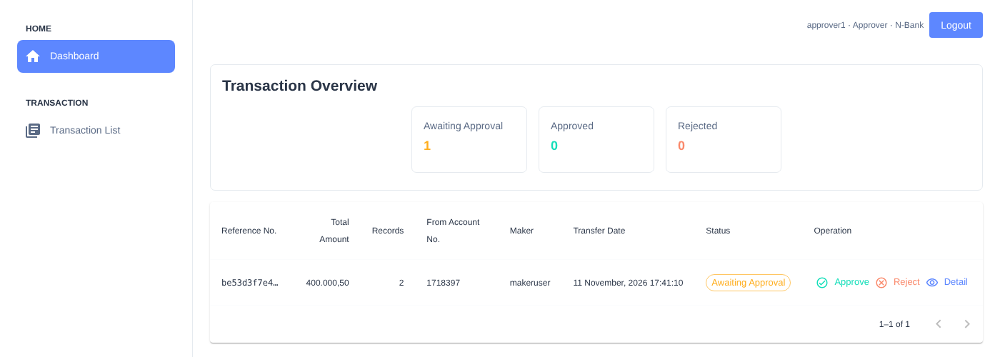

# banking-transaction-fe

The web app for [banking-transaction-be](https://github.com/rizanw/banking-transaction-be): a corporate banking dashboard where **makers** upload batches of transfers and **approvers** from the same company review and approve or reject them.

Built with Next.js (App Router), TypeScript, Material UI, and NextAuth.



## Features

- **Registration with email OTP**: choose your company and role, then verify your email with a one-time code
- **Role-aware UI**: makers see the upload page; approvers see Approve and Reject on transactions awaiting their decision
- **Bulk upload**: download the CSV template, upload a batch, and see per-row validation errors from the API
- **Immediate or scheduled transfers**: pick a future date and time for standing instructions
- **Dashboard**: counts per status, and the transactions that need attention (approvers see what's awaiting approval)
- **Transaction list**: filter by status and date range, and open any transaction to see its transfer rows
- **Sessions**: NextAuth stores the API token in an encrypted session cookie; signing out also revokes the token on the API

## Getting started

Requires Node.js 18+ and a running [banking-transaction-be](https://github.com/rizanw/banking-transaction-be).

```bash
git clone https://github.com/rizanw/banking-transaction-fe.git
cd banking-transaction-fe
npm install

cp .env.example .env.local
# set NEXTAUTH_SECRET, e.g. with: openssl rand -base64 32

npm run dev        # http://localhost:3000
```

| Variable | Description |
|---|---|
| `NEXT_PUBLIC_API_URL` | base URL of the API, e.g. `http://localhost:8080/api` |
| `NEXTAUTH_URL` | the URL this app is served from |
| `NEXTAUTH_SECRET` | random secret for encrypting session cookies (required in production) |

To try the full flow locally:

1. Register two users in the same company, one **Maker** and one **Approver**. Without SMTP configured, the API prints OTP codes to its log.
2. Log in as the maker, download the template on **Create Transaction**, fill it in, and upload it with the matching record count and total amount.
3. Log in as the approver and approve or reject it from the dashboard.

## Project structure

```
src/
├── app/
│   ├── (DashboardLayout)/      signed-in pages: dashboard, transaction list, create transaction
│   ├── login/, register/       auth pages
│   └── api/auth/[...nextauth]/ NextAuth route
├── components/
│   ├── layout/                 header and role-aware sidebar
│   ├── widgets/                transaction table, overview cards, detail and confirmation dialogs
│   └── pages/auth/             login and registration forms
├── types/                      NextAuth session types
└── utils/
    ├── api/                    axios client, auth header, error messages
    ├── auth/                   NextAuth configuration (credentials provider → API login)
    └── roles.ts, format.ts     role and status constants, number formatting
```

## How authentication works

```
Login form ──► NextAuth (server) ──► POST /api/login ──► access token
                     │
                     └── stored in NextAuth's encrypted JWT session cookie
Pages ──► getSession() ──► Authorization: Bearer <token> ──► API
Logout ──► NextAuth signOut event ──► POST /api/logout (token revoked)
```

If the API answers `401` (expired or revoked token), the app signs out and returns to the login page.

## Tech stack

Next.js 14 · React 18 · TypeScript · Material UI 5 (+ MUI X Date Pickers) · NextAuth 4 · axios · moment
